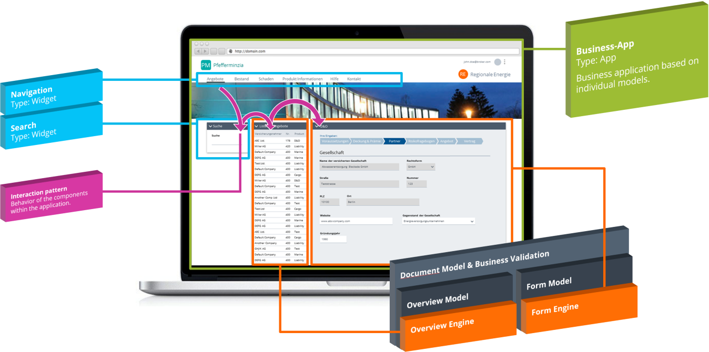
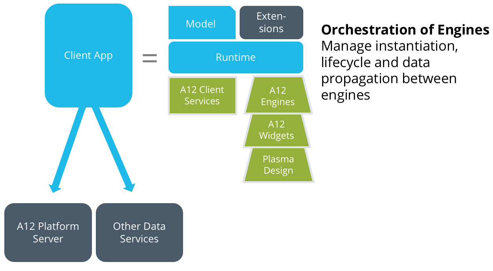

////
SPDX-License-Identifier: EUPL-1.2 OR LicenseRef-commercial

Copyright (c) 2012-2026 mgm technology partners GmbH

Dual License
------------
This source file is part of the mgm A12 Platform and available under
a choice of two different licenses:

1. Open-Source License - EUPL v1.2
   You may redistribute and/or modify this file under the terms of the
   European Union Public License, version 1.2 - see https://eupl.eu/.

2. Commercial License
   Alternatively, you may obtain a commercial license from
   mgm technology partners GmbH, that permits use of this software
   under different terms (including support and maintenance services).

   Please contact a12-license@mgm-tp.com for more information.

You must select and comply with exactly one of the above license options.

Warranty Disclaimer (applies to either option)
----------------------------------------------
THIS SOFTWARE IS PROVIDED "AS IS" AND WITHOUT WARRANTY OF ANY KIND,
WHETHER EXPRESS OR IMPLIED, INCLUDING BUT NOT LIMITED TO THE WARRANTIES
OF MERCHANTABILITY, FITNESS FOR A PARTICULAR PURPOSE AND
NON-INFRINGEMENT, EXCEPT WHERE SUCH DISCLAIMERS ARE HELD TO BE
LEGALLY INVALID. SEE THE RESPECTIVE LICENSE TEXT FOR DETAILS.
////

= Introduction

With the Client we pursuit a model-driven solution for building the client-side of business applications.

The Client uses the same model based approach like the Engines, i.e., an *Application Model* along with an interpreter that describes the UI structure and the user interaction behavior of the client application. Therefore, the model introduces high-level concepts that are independent of the underlying Client technologies.

It can also be seen as an orchestrator for the Engines and Widgets. The A12 team *hides a lot of complexity within the Engines* and the Services (like validation/computation), so that the Client runtime can be focused and lean.

Further features for the Client are:

* Support for desktop and mobile devices out of the box. Note that while Plasma is not mobile-first, it ensures usability and consistency across device classes.
* Flexible UI frame according to guidelines by A12 UI/UX team. Client has the concept of frame regions (in which views live) that improve upon the rigid three-pane layout of former UX approaches.
* Extensible by various mechanisms like factories and inversion of control. 
* Modern and lean technology stack: just TypeScript, React, Redux, Redux-Saga as well as Engines, Widgets, and Services.
