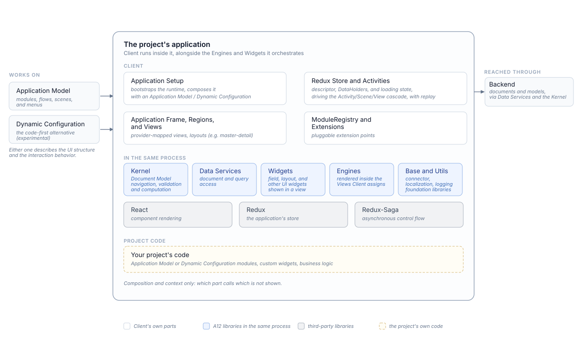
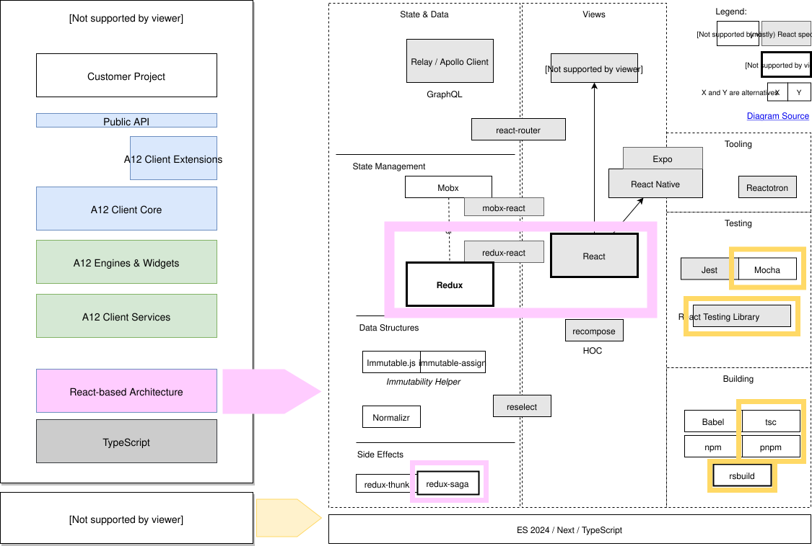

////
SPDX-License-Identifier: EUPL-1.2 OR LicenseRef-commercial

Copyright (c) 2012-2026 mgm technology partners GmbH

Dual License
------------
This source file is part of the mgm A12 Platform and available under
a choice of two different licenses:

1. Open-Source License - EUPL v1.2
   You may redistribute and/or modify this file under the terms of the
   European Union Public License, version 1.2 - see https://eupl.eu/.

2. Commercial License
   Alternatively, you may obtain a commercial license from
   mgm technology partners GmbH, that permits use of this software
   under different terms (including support and maintenance services).

   Please contact a12-license@mgm-tp.com for more information.

You must select and comply with exactly one of the above license options.

Warranty Disclaimer (applies to either option)
----------------------------------------------
THIS SOFTWARE IS PROVIDED "AS IS" AND WITHOUT WARRANTY OF ANY KIND,
WHETHER EXPRESS OR IMPLIED, INCLUDING BUT NOT LIMITED TO THE WARRANTIES
OF MERCHANTABILITY, FITNESS FOR A PARTICULAR PURPOSE AND
NON-INFRINGEMENT, EXCEPT WHERE SUCH DISCLAIMERS ARE HELD TO BE
LEGALLY INVALID. SEE THE RESPECTIVE LICENSE TEXT FOR DETAILS.
////

= Introduction

[#functionality]
== Functionality

Client provides the A12 client runtime: a model-driven, extensible framework for the client side of business applications.
It orchestrates the Engines and Widgets inside a page built to the guidelines of A12's UI/UX team, hiding most of their complexity from the application code.
The UI structure and the interaction behavior are described independently of the underlying client technologies, either in an Application Model or, for new applications, in a code-first Dynamic Configuration (currently marked experimental).
Client works on both desktop and mobile devices out of the box.
It is extensible through factories, inversion of control, and a module system for project-specific or third-party code.

Client does not implement the Engines it hosts.
Each Engine owns its own rendering and behavior; see the respective Engine's documentation.

The individual field, layout, and other UI widgets shown inside a View come from Widgets, not from Client.

Validation and computation rules, written in the Kernel Language, are evaluated by the Kernel, and data access is the responsibility of Data Services.

Client does not authenticate or authorize the user either: the application signs the user in, typically against A12's User Authentication and Authorization component, and configures the server connector accordingly.
Client keeps no authentication state of its own and performs no authorization checks; role-based authorization is enforced by the services it calls.

[#architecture]
== Architecture

Client is a client-side library that runs inside the browser process of an A12 application, alongside the Engines and Widgets it orchestrates.
It is built on Redux, following the Immutable App Architecture with a single, unidirectional store, and on Redux-Saga for asynchronous control flow.

Its main building blocks are:

* *Application Setup*, which bootstraps the runtime and composes it with an *Application Model* or a *Dynamic Configuration*.
* *the Redux store*, with *Activities* as the central data structure of a use case.
  Creating or changing an Activity drives the *Activity/Scene/View cascade*: a Region selector matches the Activity Descriptor against a Scene, interprets that Scene's Directives into a Region specification, and rebuilds the View assignment of each Region through a replay algorithm whenever Activities are created or finished.
* the *Application Frame*, *Regions*, and *Views*: a provider mechanism maps the names in a Region specification to actual UI components, and a Layout, either one of Client's built-in Layouts or one the project supplies, renders the Views assigned to a Region.
  The Application Frame is the platform's standard top-level Layout of header, navigation, sidebar, and content, but projects are free to define their own Layouts and Views.
* the *ModuleRegistry*: the central extension point through which project or third-party code registers reducers, sagas, Views, and other contributions into the running application.

`client-core` ships a fixed set of further extension modules as separate entry points.
They are opt-in building blocks that a project registers explicitly through the ModuleRegistry or the application setup, not active by default: an adapter for combining multiple Application Models, a Data Services adapter that adds a Data-Services-backed configuration slice to the Redux store for Engines to consume, deep linking, dirty handling, <</features/heterogeneity, heterogeneity>>, localization, the default model loader, and notifications.

Document Model and Document navigation and its types come from the Kernel.
Through the Kernel and Data Services, Client's data ultimately reaches the Backend; see their documentation.

See <<architecture-details,the Architecture chapter>> for a deeper look at Client's structure and mechanisms.

.Client Overview

[#artifacts]
== Artifacts

The entry points a project declares in its build or invokes on the command line, not the full set of published modules:

[cols="2,3"]
|===
| Artifact | Purpose

| `client-core` (npm, `@com.mgmtp.a12.client`)
| The client runtime: interprets the Application Model or a Dynamic Configuration and orchestrates Activities, Views, and the Engines inside the Application Frame.

| `client-application-model-migration` (npm, `@com.mgmtp.a12.client`)
| The command-line tool for migrating Application Model files across A12 releases.

| `client-data` (npm, `@com.mgmtp.a12.client`)
| An experimental data-access library for client-side components.
|===

`client-core` declares its platform context as peer dependencies, provided by the consuming application: the Kernel's runtime API and Document Model facade, Data Services access, Widgets, the foundation libraries Base, Utils Connector, Utils Localization, and Utils Logging, and the React, Redux, and Redux-Saga stack.

[#technologies]
== Technologies

Client is a front-end library based on React and Redux, written in TypeScript, and built via Node.js.
It is published as ECMAScript modules and ships its own type declarations, source maps, and non-obfuscated sources, so that debugging into Client code stays practical.

The Client architecture invests fully in the React ecosystem. We have chosen the following technologies:

* *TypeScript*: statically typed, with features that allow for truly scalable (code-wise) application development. React, Redux, and Redux-Saga are all covered by type declarations, so it becomes even safer to use these libraries.
* *React*: efficient rendering of the UI component tree ("virtual DOM") without caring about current DOM state, i.e., no data binding required. React is also at the core of the Engines and Widgets.
* We have applied best practices like functional rendering, separation of container and presentational components, and extensions through wrapping with higher order components (HOCs).
* *Redux*: easy-to-understand unidirectional data flow. It follows heavily the functional paradigm instead of object-oriented. Redux enables the Immutable App Architecture, which is the core of the Client architecture.
* *Sagas*: make complex asynchronous control flows look like synchronous code. Sagas are elegant for any kind of background work that you would put into threads in Java.

Working with the Client requires understanding the Redux concepts like store, state, reducer, middleware, action, action creator; and also how connecting React components works via a store provider and the hooks of the "react-redux" library.

Sagas are, like middlewares and specially thunks, a way to introduce impure effects into the pure functional world of Redux, like asynchronous I/O. However, unlike thunks, sagas express these asynchronous steps in conventional sequential manner (by utilizing JavaScript generators, which yield the effects the saga middleware then executes).

Sagas are background generator functions that typically are triggered by incoming actions and then start off complex steps. Note that the `take` effect (and any variants), that waits for an action in a saga, returns *only after the store changes happened* and all middlewares and reducers are already executed for a specific action. Meaning that a saga can only react but not change or discard actions (unlike middleware).

[#terminology]
== Terminology

[cols="1,3"]
|===
| Term | Meaning

| Activity
| The runtime state of one use case: it carries an Activity Descriptor, its business data in one or more DataHolders, and a loading state.

| Activity Descriptor
| The key/value description of what an Activity is doing, used to match the Scene that configures the UI for it.

| View
| An identifiable content part of the UI, assigned to a Region and rendering an Engine or a custom UI component.

| Region
| A named Layout location inside the Application Frame or a custom Layout: the three standard Regions are content, sidebar, and modal, and projects can define their own.

| Application Frame
| The platform's standard page structure of header, navigation, sidebar, and content, defined by A12's UI/UX guidelines.

| Application Model
| The JSON-based description of an application's Modules, Flows, Scenes, and Menus that drives which Views appear in which Regions.
  Not to be confused with a data model, which consists of Document Models and Relationship Models and describes business data rather than UI structure.

| Dynamic Configuration
| The code-first, TypeScript-based alternative to the Application Model; currently marked experimental.

| Model Graph
| Runtime information about the models of an application and how they refer to one another, loaded from an A12 Server and held in the Redux store.
  Its main part is the data models and their relations: Document Models with their relations and subtypes, Composed Document Models, and Relationship Models.
  The Model Graph is not restricted to them, however.
  Every other model is carried as a generic model, with its model type and its model references, and that includes UI models such as Form and Overview Models as well as Application Models.
  Client requires the Model Graph for <</features/heterogeneity, heterogeneity>>, which looks up subtype relations in it, and for the default model loader, which resolves model references through it.
|===
