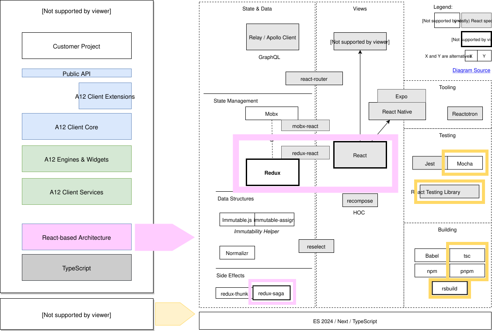
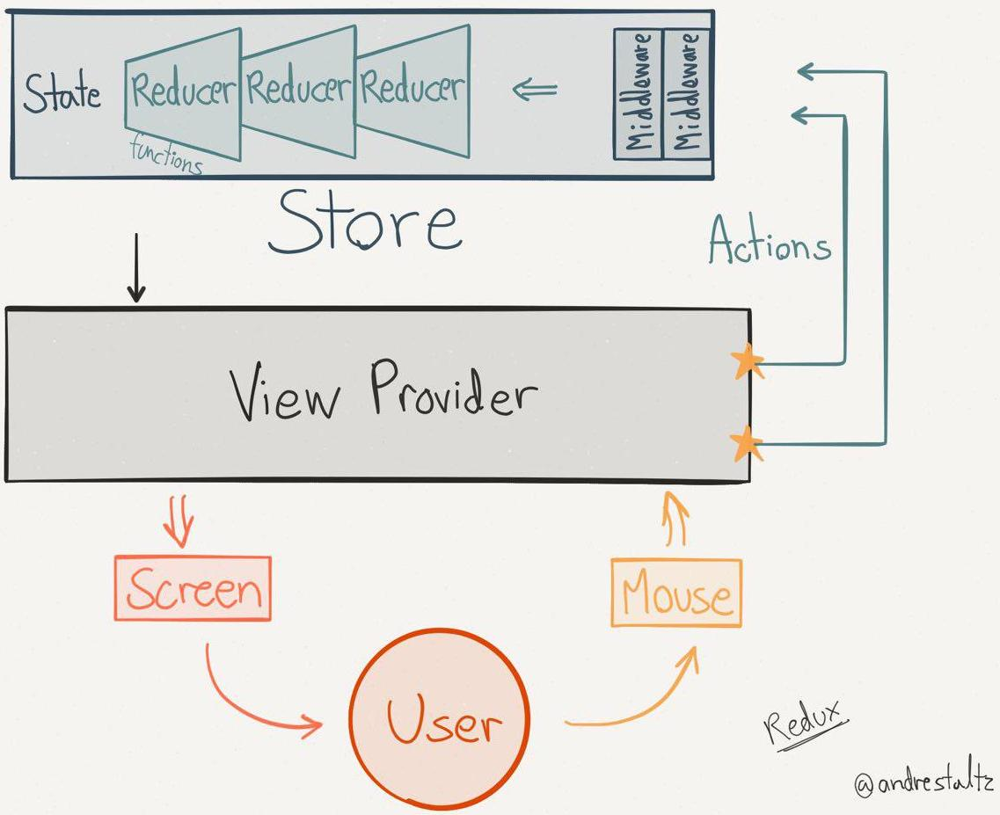
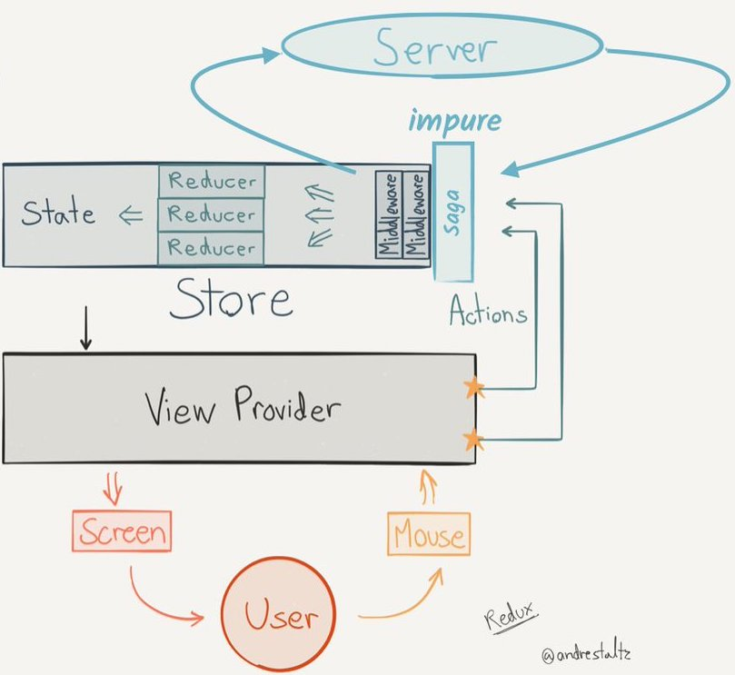

////
SPDX-License-Identifier: EUPL-1.2 OR LicenseRef-commercial

Copyright (c) 2012-2026 mgm technology partners GmbH

Dual License
------------
This source file is part of the mgm A12 Platform and available under
a choice of two different licenses:

1. Open-Source License - EUPL v1.2
   You may redistribute and/or modify this file under the terms of the
   European Union Public License, version 1.2 - see https://eupl.eu/.

2. Commercial License
   Alternatively, you may obtain a commercial license from
   mgm technology partners GmbH, that permits use of this software
   under different terms (including support and maintenance services).

   Please contact a12-license@mgm-tp.com for more information.

You must select and comply with exactly one of the above license options.

Warranty Disclaimer (applies to either option)
----------------------------------------------
THIS SOFTWARE IS PROVIDED "AS IS" AND WITHOUT WARRANTY OF ANY KIND,
WHETHER EXPRESS OR IMPLIED, INCLUDING BUT NOT LIMITED TO THE WARRANTIES
OF MERCHANTABILITY, FITNESS FOR A PARTICULAR PURPOSE AND
NON-INFRINGEMENT, EXCEPT WHERE SUCH DISCLAIMERS ARE HELD TO BE
LEGALLY INVALID. SEE THE RESPECTIVE LICENSE TEXT FOR DETAILS.
////

= Technologies

Client is a front-end platform based on https://reactjs.org/[React,role=external,window=_blank] libraries, written in https://www.typescriptlang.org/[TypeScript,role=external,window=_blank], and built via https://nodejs.org/[Node.js,role=external,window=_blank].

The Client architecture invests fully in the React ecosystem. We have chosen the following technologies:

* *TypeScript*: It's static typed (but weak typed) with features that allow for truly scalable (code-wise) application development. Although React and Redux are JavaScript, we use the available TypeScript typings, so it becomes even safer to use these libraries.
* *React*: efficient rendering of the UI component tree ("virtual DOM") without caring about current DOM state, i.e., no data binding required. React is also at the core of the Engines and Widgets.
* We have applied best practices like functional rendering, separation of container and presentational components, and extensions through wrapping with higher order components (HOCs).
* *Redux*: easy-to-understand unidirectional data flow. It follows heavily the functional paradigm instead of object-orientated. Redux enables the https://medium.com/react-weekly/embracing-immutable-architecture-dc04e3f08543[Immutable App Architecture,role=external,window=_blank], which is the core of the Client architecture.
* *Sagas*: make complex asynchronous control flows look like synchronous code. Sagas are elegant for any kind of background work that you would put into threads in Java.

Please understand the Redux concepts like store, state, reducer, middleware, action, action creator; and also how connecting React components works via provider and the `connect` functions of the "react-redux" library.

"]

Sagas are, like middleware and specially https://github.com/reduxjs/redux-thunk[thunks,role=external,window=_blank], a way to introduce impure effects into the pure functional world of Redux, like asynchronous I/O. However, unlike thunks, sagas express these asynchronous steps in conventional sequential manner (by utilizing JavaScript generators combined with async and await).

With Redux-Saga, the situation changes slightly:

"]

Sagas are background generator functions that typically are triggered by incoming actions and then start off complex steps.

Note that the `take` effect (and any variants), that waits for an action in a saga, returns *only after the store changes happened* and all middlewares and reducers are already executed for a specific action. Meaning that a saga can only react but not change or discard actions (unlike middleware).
