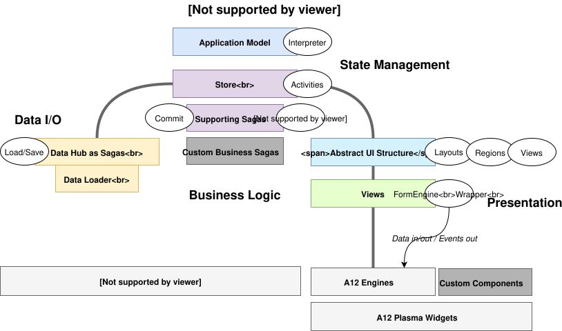

////
SPDX-License-Identifier: EUPL-1.2 OR LicenseRef-commercial
Copyright (c) 2012-2026 mgm technology partners GmbH
See LICENSE file for details. For commercial licensing: a12-license@mgm-tp.com
////

[#/introduction/principles]
= Principles

The following diagram shows the principal structuring of the Client into modules and their responsibilities in the architecture.

The Client modules fall in one of these categories:

* State Management
* Application Model
* Store
* Supporting Sagas
* Data I/O
* Data Hub with the DataLoaders/DataEditors
* DataProvider Principles
* Presentation
* Abstract UI Structures
* Views
* Business Logic
