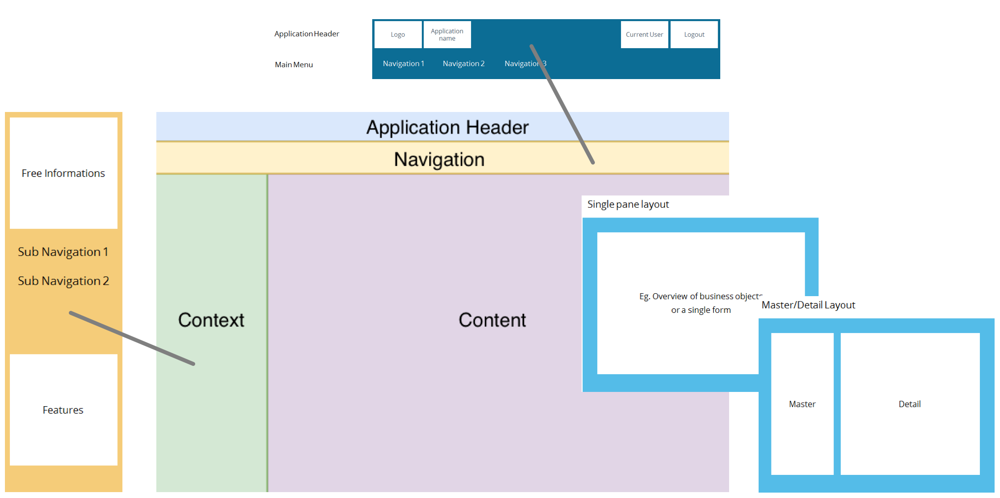

////
SPDX-License-Identifier: EUPL-1.2 OR LicenseRef-commercial
Copyright (c) 2012-2026 mgm technology partners GmbH
See LICENSE file for details. For commercial licensing: a12-license@mgm-tp.com
////

= Application Frame

== Elements of the Application Frame

The A12 UI/UX team has defined a specific structure for the Plasma design that is called application frame. It consists of four distinguished elements:

* *Application Header*: contains e.g. logo, selected locale, user, and role information
* *Navigation*: shows the main menu
* *Context (Sidebar)*: displays additional information, context-related actions, and allows for sub navigation
* *Content*: shows for example the Engines in specific layouts, e.g., a master-detail layout.

