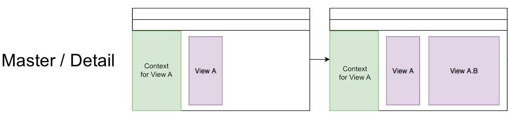
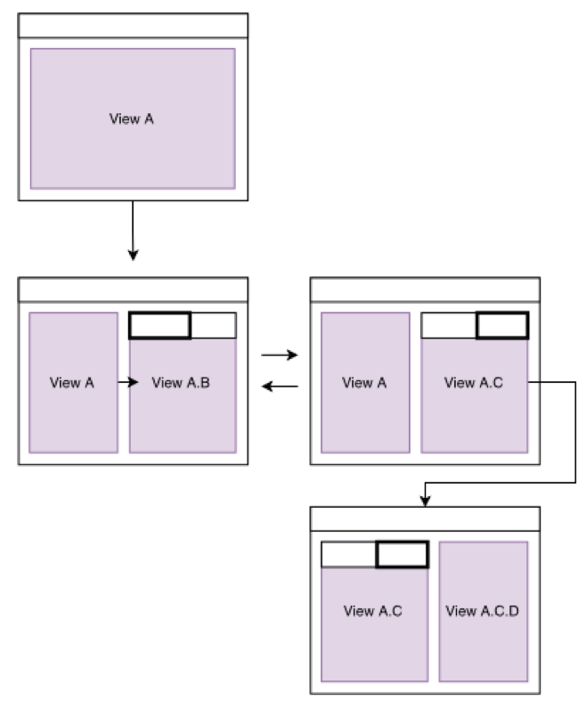
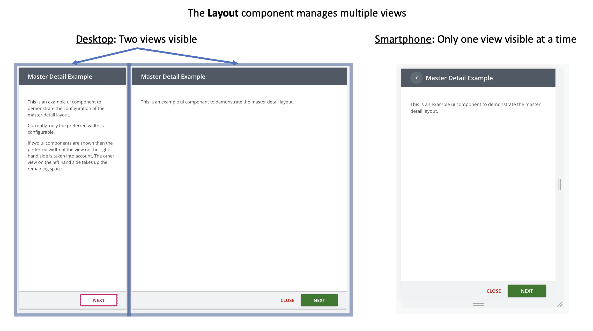
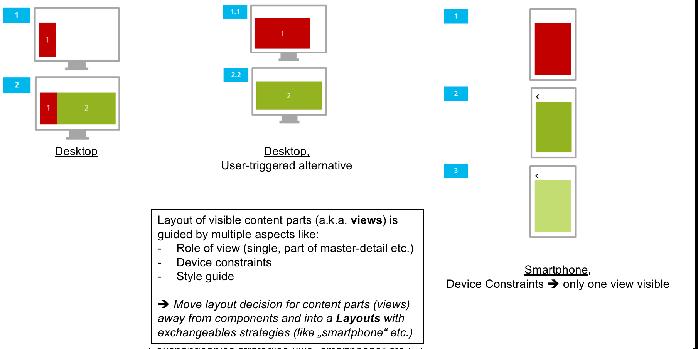
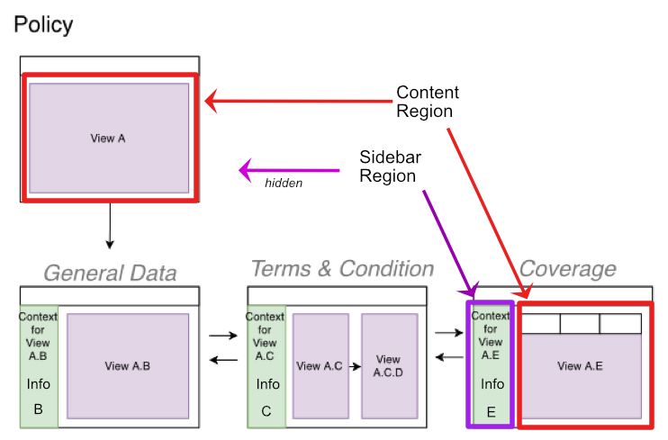
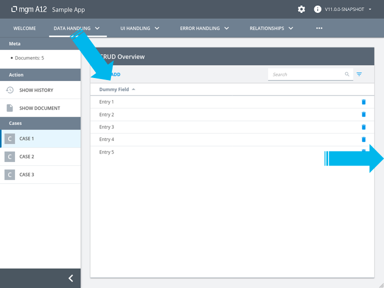
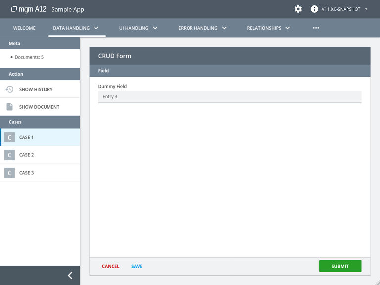
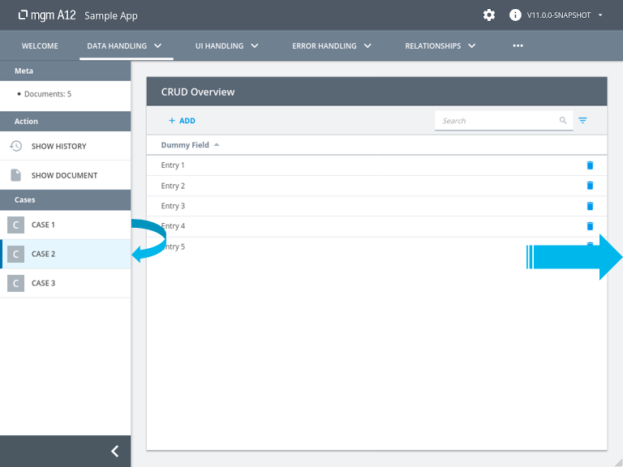
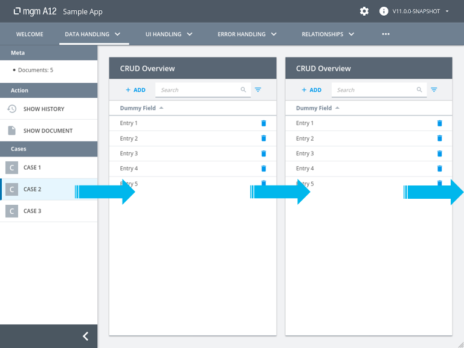

////
SPDX-License-Identifier: EUPL-1.2 OR LicenseRef-commercial
Copyright (c) 2012-2026 mgm technology partners GmbH
See LICENSE file for details. For commercial licensing: a12-license@mgm-tp.com
////

= Views

[#/basics/views/arranging-uis]
== Arranging UIs

The Application Model is an A12 UI Model for defining the “macroscopic” UI aspects of applications based on link:/docs/PLASMA/plasma-concept-documentation/index.html[Plasma for Business Applications]. This includes

* main menu
* regions
* views

Inner parts of the UI can also be created using A12, but this is done using other A12 components, e.g. Engines based on Form and Overview Model.

Each Application Model consists of _Modules_. A Module is a high level building block of the application and directly accessible via the main menu. It consists mainly of:

* (optional) menu entry
* flows with scenes

Menu defines the main menu entry of the Module and which Activity is started when it is selected.

The scenes define the actual functionality of the Module. Each scene consists of

* match conditions
* enter and leave directives
* cases

[#/basics/views/match-conditions]
=== Match Conditions

Match conditions define when the scene applies. They always refer to the <</basics/activity/activity-descriptor,Activity Descriptor>>. The Application Model supports the following matching strategies:

* *mustEqual:* a property must equal a (constant) value
* *isSet:* a property must be set

[#/basics/views/directives]
=== Directives

If the scene applies, the respective scene is “entered” and the enter directives are executed. If the scene no longer applies, the respective “leave” directives are executed.

The available directives are

* _VIEW_ADD_
* _REGION_CLEAR_

The VIEW_ADD directive has the following parameters:

* *Region:* Defines to which Region the view should be added. If no region is defined, the `defaultRegion` property of the Application Model is used.
* *Name:* Defines the name of the React/Redux UI component that is responsible for visualizing the view.

[WARNING]
====
In addition, make sure that the UI component is provided by the _View Factory_ configured in the application setup.
====

* *Constraints:* Contains configurable constraints for the current layout. There are the following pre-defined properties:
** `type`: refers to the layout to be configured. Some properties can only be specified for certain types. Currently the only built-in type is "MasterDetail"
** `preferredWidth`: only available for type "MasterDetail". Determines the preferred width of the rightmost view. If another view is visible on the left hand side, this other view will take up the remaining space. Note that this property is only evaluated for "detail" views, because when having just a single view (the "master"), it will always take up the full width.
* *Configuration:* Contains configurable constraints for the current view.
* *models:* an optional array of model descriptor objects. Each of them describes an A12 model to be loaded. Whenever this array is defined, the runtime automatically triggers model and data loading for this scene
* *loadData:* an optional boolean flag. When set to true, the runtime automatically triggers data loading for this scene. This flag is only required, if you want to load data without having any A12 models.

[NOTE]
====
Setting `loadData` to false will not prevent data loading, if there are models defined for the current view (see <</basics/data-loading,Data Loading>>). However you can prevent data loading by

* not defining models and setting loadData to false/undefined
* manually setting the loadingState of the activity to "without"
====

The REGION_CLEAR directive has the following parameters:

* *Region:* Defines which Region should be cleared. If no region is defined, the `defaultRegion` property of the Application Model is used.
* *Layout:* Sets the layout for the Region. If no layout is defined, the layout from its region is used.

=== Regions

Regions are visual locations inside the page. Currently, there are three regions available:
_CONTENT_, _SIDEBAR_ and _MODAL_.

* Views placed in _CONTENT_ will appear in the content area of the application frame widget.
* Views placed in _SIDEBAR_ will appear in the sidebar of the application frame widget.
* Views placed in _MODAL_ will appear in a modal dialog.

=== Cases

_Cases_ are an advanced feature to switch between different UIs without changing Activities.

== Views are Identifiable Content Parts

The A12 UI UX team has analyzed several layouts and UI flows from existing projects. Below are shown the most common ones.

=== Master/Detail

The most simple is the master/detail layout. Here's an illustration:

The master is here denoted as "View A" and is typically a data-browser, i.e., a list of business objects in rows. A12 calls this an "*overview*". The controls for filtering, sorting and search criteria are here part of View A for simplicity, but search criteria can also be a view on its own. Also note the sidebar with optional information about the overview. By selecting a row you open and edit the details of the corresponding business object, here represented as "View A.B". For example, this is a form with all attributes as fields and input controls.

This example uses two content parts, which we will denote "*views*": the overview in a first view, the detail view in a second view. Now let's see some more challenging examples.

=== Nested Details

The role of being a master and a detail is not fixed, meaning that a detail can become master and open a new, nested detail. In the following example:

. The overview in "View A" is a master, shown fully maximized.
. Selecting a row in the overview brings up the details of the respective business object in "View A.B".
* Using tabs in the detail view, the information of the business object can be broken down into multiple forms, here "View A.B" (the default view of the business object) and "View A.C". For example let's say that the business object is an insurance policy and "View A.B" is the general data and "View A.C" is the list of terms&conditions, which is shown again as an overview.
. Selecting a row in "View A.C" which is a list of terms&conditions as an overview, brings up the details of the corresponding term&condition item in "View A.C.D" as a form. Please note that the term&condition item is seen here as nested (or contained) business object of the policy. Thinking this way, we can apply our concepts in a recursive manner.

==== View Assignment

Let's break this down into an assignment of views:

* Overview "View A" is assigned the view #1.
* "View A.B" and "View A.C" are different "details" of the selected business object, here a policy with the details "general data" (B) and "terms&conditions" \(C). Both render their content into a view. Note that switching tabs to change between "View A.B" and "View A.C" does change the view assignment and layout.
* "View A.C.D" is the detail of the selected term&condition item and is assigned a new view.

==== Layout

Now let's specify the layout with a focus on visibility: For a desktop, the content area can only show up to two views. That means for our example:

* view #1 appears maximized if alone.
* If view #2 appears, view #1 for the overview moves to the left and shrinks.
* If view #3 appears, view #2 moves to the left and view #1 is hidden and effectively disappears.

The layout rules can be dependent on device class and available screen space. For example, a smart phone might only show the latest view, or render views from top to bottom.

==== Summary

In summary, these points are important:

* Activities open up one (or even multiple) views
* A view can use tabs internally in order to show different aspects about the business object respective the activity. Another option is to use views and switch between them, as discussed in the subsection below.
* Layout rules can organize views on screen, like maximizing, minimizing, proportions, max shown views, etc.

=== Changing Context in the Sidebar Region

Usually, each activity is tied to something like a result list (overview) or a business object. Each view of an activity can have its own context information in the sidebar. For an insurance policy this e.g. is the title, insured sum and other key data, but also an action panel with buttons for printing, progressing the workflow state, etc., is useful.

Until now we have assigned views to the content region only. But the sidebar region can also contain views. In general, regions contain views, and the application frame has two standard regions: the content and sidebar areas.

If we break this down, we can assign views for the example above to the *sidebar* as follows:

* "View A" has no sidebar content, thus the sidebar is hidden.
* For "View A.B" has specific sidebar content, for example "policy info" in "Info" which is assigned view #S1 and an action panel "B" which is assigned view #S2a.
* For "View A.C" (which is another view of the same activity as "View A.B"), the sidebar continues to show "Info" in view #S1, removes any other view in the sidebar and adds a new view #S2b for the action panel "C" for terms & conditions.
* For "View A.D" (again another view of the same activity as "View A.B" and "View A.C"), the sidebar again continues to show view #S1, but again removes any other view in the sidebar and adds a new view #S2c for the action panel "E" for coverage.

==== Thinking in View Directives

You might wonder why we focus on the sequence of delta changes when navigating between the views and not just specify how each view should look. The reason is that activities and view navigation actually express these delta changes by using *directives*: "VIEW_ADD" (add view named X to region Y) and "REGION_CLEAR" (clear region Y, i.e., remove all previously assigned views). We will learn much more about this in the section about the Application Model.

==== Summary

In summary, these points are important:

* The application frame has two regions that contain views: content area and sidebar. Others are possible, but must be added explicitly by the projects.
* Views can be assigned and removed to achieve view-dependent dynamic content in the regions.

[#/basics/views/example-design-study]
== Example: Design Study

We now want to apply the ideas to a example. 

As can be seen below, the application frame shows a menu in the header. Clicking on the menu entry opens the overview. This action technically does the following:

* Starts a new overview activity.
* Allocates a view in the content region.
* Renders an Overview Engine with a result list of selectable objects.

Selecting a specific row opens up the details about the corresponding entry. From the technically perspective, this again starts a new activity for editing the objects and changes the regions like this:

* Three views are assigned to the sidebar: an information panel, an action panel, and a view selection menu.
* One view in the content area with a Form Engine.

=== Clearing a Region
 
Note that the Form Engine view is shown maximized even though an overview view exists. The view assignment for the activity specified in the Application Model causes all regions to be _cleared_. If a previous activity has assigned views to a certain region, these views are ignored by the layout manager if the region is cleared on behalf of the current/active activity.

The screenshot below illustrates the next user interaction, where the user switches between cases which results in a change in layout:

* The first view is _removed_ and replaced by a new view which in this case is an overview.
* Note that the sidebar stays the same.

The overview shows another list and can be seen as a "master". A click in a row brings up the details for the selected item (see the blue arrow on the right side of the illustration below). This starts a new, nested activity.

The next screenshot shows the result of this activity:

* The view for the overview is _kept_.
* A new view in the content area region is allocated and shows another overview.
* The sidebar stays the same.

