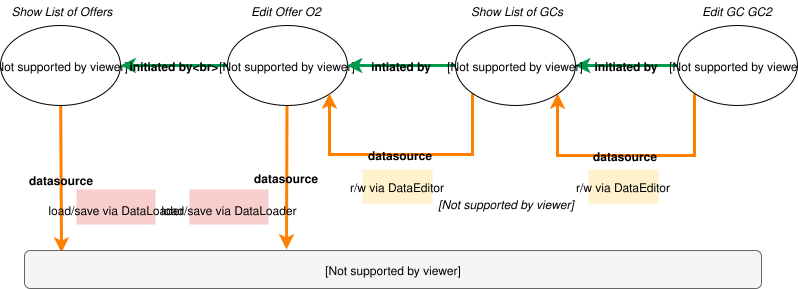

////
SPDX-License-Identifier: EUPL-1.2 OR LicenseRef-commercial
Copyright (c) 2012-2026 mgm technology partners GmbH
See LICENSE file for details. For commercial licensing: a12-license@mgm-tp.com
////

[#/basics/activity]
= Activity

In the previous section, we introduced the concept of "activities" in a somewhat vague way. Activities are a very important client-side Concept and are actually quite well specified.

An activity can be seen as a bracket around user interactions, another term for this bracket is "use case" (taken from requirement engineering).
Typical use cases are:

* Overview: showing a list of business objects as a result of a search. Typical user interactions are: scrolling/paging, sorting, filtering, refining search criteria.
* Editing a business object like using a form.

The Client has special support for these typical use cases, but any user interactions can be managed as an activity. The DevApp shows a variety of activities.

In order to drive the use case, an activity holds all the relevant data and state, and provides the UI component (indirectly though) for interacting with the data.

== Activity Data Structure

* <</basics/activity/activity-descriptor,Activity Descriptor>>
* <</basics/activity/properties,Properties>>
* <</basics/activity/operations-on-activities,Operations on Activities>>
* <</basics/activity/data-loading,Data Loading>>
* <</basics/activity/linking-activities,Linking Activities>>

Technically, an activity is a data structure in the Redux store that holds all information of what the runtime and the application UI component need to know about this use case instance.

[source,tsx]
----
export interface Activity {
  readonly id: string;
  readonly descriptor: ActivityDescriptor;
  readonly initiatingActivityId?: string;
  // ...
}

export interface ActivityDescriptor {
  readonly instance?: string; // e.g. „P2“
  readonly [key: string]: string | undefined;
}

----

[#/basics/activity/activity-descriptor]
=== Activity Descriptor

The Activity Descriptor is a key/value-map that specifies what the activity is doing, e.g., the type of use case and details like the ID of the business object.

The idea is to separate the intention, i.e., _"What should be done"_ from the interpretation and implementation of _"How should it be done"_. The _"what"_ is the Activity Descriptor and it is the responsibility of the activity creator to specify it. The _"how"_ is specified by "use case matches" in the <</basics/application-model,Application Model>>.

==== Pre-defined Key

There is one key with a pre-defined meaning: The instance key specifies the ID of the business object, or in A12 context, the A12 data document ID. For creating a new document the constant `NEW_INSTANCE_IDENTIFIER` (```"&#95;&#95;NEW&#95;&#95;"```) from `core/application` should be used.

It is pre-defined in the sense that the provides I/O (loading/saving) and UI components that interpret this key in the following way: if a Form Model has been specified in the matching scene and the instance is set in the descriptor, e.g., `{ "instance": "P222" }`, this is interpreted as the use case "Editing data in a form": load the document for the specified business object and bring up a form. This uses the Document Model which is referenced in the specified Form Model.

[#/basics/activity/properties]
=== Properties

Let's break down the most important properties.

* `id`: each activity needs a unique identifier. The identifier also allows "weak" references to the activity, i.e., without using object references, which are problematic w.r.t. the "immutable state" principle of Redux. You are responsible for assigning unique ids to activities. If you 
want to cancel and recreate an activity, a new id must be set to differentiate it from previous activities.
* `initiatingActivityId` and `sourceActivityId`: see <</basics/activity/linking-activities,details below>>.
* `case`: this relates to the UI and scenes. See <</basics/application-model/cases,Cases>> for details.
* `dataHolders`: each activity has a list of DataHolder objects. Each of them is responsible for one data source and has its own data descriptor see <</basics/activity/data-holder,details below>>.

[#/basics/activity/data-holder]
=== DataHolder

A DataHolder is responsible for the data of one data source within an activity.
It consists of a `descriptor` to specify what kind of data is being stored as well as other properties to keep track of the data. The Activity Descriptor is then only relevant for determining a matching scene from the Application Model.

When an activity is created, it is initialized with one default DataHolder, which gets the activity's descriptor as its DataHolder descriptor. More DataHolders can be added to the activity later.

The `error` property of the DataHolder is intended for tracking `"loading"` or `"saving"` errors. For tracking other errors it is recommended to store them inside the `slices` property of the DataHolder. This can be easily achieved by creating a custom action and a custom DataReducers.

[NOTE]
====
A technical action (like "setData") to set arbitrary data of a DataHolder is not recommended, because actions should be named from a business perspective. See the <</basics/activity/data-loading,Data Loading>> section below for alternatives.
====

All properties of the DataHolder are described in more details in the API reference.

==== Example

Here is an example of an activity that has a list with three DataHolders. There is one DataHolder storing the document data of the activity, and two other DataHolders storing link and candidate relationship data.

[source,tsx]
----
const activity = {
    id: "223",
    descriptor: {
        model: "Product",
        instance: "DomainProduct/15"
    },
    dataHolders: [
        {
            descriptor: { model: "Product", instance: "DomainProduct/15"},
            data: {},
            dirty: "false",
            loadingState: "missing",
            savingState: "not_saved"
        },
        {
            descriptor: { type: "candidate", instance: "1" },
            data: { /*...*/ },
            dirty: "false",
            loadingState: "loaded",
            savingState: "not_saved"
        },
        {
            descriptor: { type: "link", instance: "1" },
            data: { /*...*/ },
            dirty: "false",
            loadingState: "loaded",
            savingState: "not_saved"
        }
    ]
};
----

[#/basics/activity/operations-on-activities]
=== Operations on Activities

==== Creating an Activity

There are some pre-defined Redux action factories for working with activities.

Use the `create` function to create the Redux action `PUSH` that creates (or "pushes") a new activity:

[source,tsx]
----
function create({ activityId, activityDescriptor, initiatingActivityId, data, loadingState, slices }: CreatePayload): Action<PushPayload> { /*...*/ };
----
Make sure that activityId uniquely identifies an activity across the lifetime of the user session. Failure to do so might result in unintended behavior (e.g. skipping of model loading). If you 
want to cancel and recreate an activity, a new id must be set to differentiate it from previous activities. 

If you want to create a new activity with data already in place, the recommended way would be to hand in this data via the optional data property of the params object.

If you still want to update the data of the activity directly after the creation, e.g. dispatching the `ActivityActions.setData` action directly afterwards, you need to wait with the dispatch, until the data and models resulting from dispatching `create` are present in the store. Otherwise, the data you want to set with setData would be overwritten! This is due to the asynchronous model and data loading, that happens after dispatching `create`.

[#/basics/activity/data-loading]
=== Data Loading

Most activity types require data and also models, e.g., an overview has the list of search results and the Overview Model; the Form Engine requires the document data for the business object and also the document and UI models. This information is kept in the `data` property, which has an internal structure depending on the activity type.

When an activity is created, like in the examples above, all that is required is the Activity Descriptor. Passing data is optional. Typically loading data and models is and should be delegated to the runtime, specifically to the DataHandlers.footnote:[Knowing _which_ model(s) to load, is the responsibility of the selected DataLoader; the details will be described later on.]

The property `loadingState` tracks the progress and gives information about the outcome:

* `"without"`: the activity does not require any data, and the `data` property is `undefined`.
* `"missing"`: the activity requires data and possibly models. The runtime has to load them. Until they are loaded, the `data` property is `undefined`.
* `"loading"`: the runtime is currently loading data and models.
* `"loaded"`: the loading of data and models was successful.
* `"error"`: there was at least one error during the loading of data and models. This information is optional.

An additional property `savingState` is a complementary tracking state for saving data.

[#/basics/activity/linking-activities]
=== Linking Activities

[#/basics/activity/initializing-of-an-activity]
==== The Initiating Activity

This is where nesting of activities comes into play. As we saw in the previous examples, activities can be easily created, like a selection in an overview master creates a form detail activity. Creating an activity is always relative to a *parent activity* (called the "initiating activity") with a reference by ID as `initiatingActivityId`. Note that the very first activity has no parent, so the ID is not set (`undefined`).

Linking activities this way creates a tree which is utilized in the Client:

* Canceling an activity will cancel all linked sub-activities.
* Committing an activity will commit all linked sub-activities.



==== The Source Activity

There is a second kind of link between activities that is concerned with where the data comes from. Data can come from an existing activity or from somewhere else (subject to the selected DataLoader), typically a server side data service.footnote:[While mixing loading data from parent activities and services is possible, we focus on the most common type here to keep things simple.]

An existing activity is either the direct parent of the activity or any parent above this parent. The id is kept in the `datasourceActivityId` property. If data comes from somewhere else, this property is not set (`undefined`).

Consider the example that is illustrated above.

== Work with Business Data

Every task that the user is working on is represented as an _activity_. An activity resembles a (possibly long-running) interaction of the user with the system, e.g. filling out a (possibly large) form, browsing data, reading a message, etc.

The main properties of an activity are

* descriptor
* data and loading state
* initiating and source activity

=== Activity Descriptor

The _Activity Descriptor_ is an outline of the activity. It declares what the activity is about. Most activities will deal with business data. Because of this, the notion of a business object is built into the descriptor. Therefore, it is possible to define an arbitrary number of _string_ properties to describe the activity. These can augment the business data or be used in activities that do not deal with business objects.

[WARNING]
====
Currently, only the property "instance" is reserved for A12 own use.
====

=== Activity Data

Of course, activities can also contain the actual data of the business object. Data that comes from one data source is typically kept in one DataHolder. The data can be of any structure, however in most cases it should be an _A12 Document_. The loading state is also held as a separate property within this DataHolder.

In addition to the actual data, there are several properties providing additional information about the activity's data:

* *loading and saving state:* tells whether the activity DataHolder contains data at all and if yes, if the data is missing, loaded or the loading failed. These are usually controlled and used by DataHandlers and related functionality.
* *lock:* can be used by business logic to prevent any changes to the DataHolder - a locked DataHolder is also considered as "dirty" - see the dirty handling feature (see below)
* *dirty information:* can be used by business logic to prevent an accidental cancellation of the activity.
+
WARNING: The feature only works if the "cancel requested" event action is used instead of the "cancel" command action.
* *error state:* Holds information about a `"loading"` or `"saving"` error that is currently present. The error has always an `errorCode` that defines the type of error and - depending on the type - additional, type specific information.

[WARNING]
====
If you create A12 documents by yourself, you need to make sure that they fulfill the interface of `Activity.Data.Document`. Next to your data your document needs to contain an `id` and a `modelId`.
For new documents you can use the constant `NEW_INSTANCE_IDENTIFIER` as the document id.
====

=== Activity Relations

If an activity has been started by another activity, then that activity is available as _initiating_ activity. If an activity obtained its data from another activity, then that activity is available as (data) _source_ activity.

=== DataReducers

The business data held in an activity can be changed by the user working on a task like filling out a form or by a system executing a technical task.
To achieve this, the Client provides the concept of <</basics/data-reducers,DataReducers>> which give fine-grained control over changes to the business data within DataHolders.

As an example, the UI state of the Form Engine is handled by a DataReducer.
