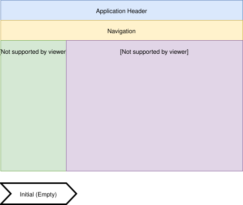
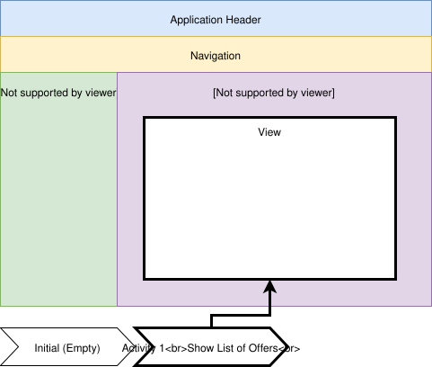
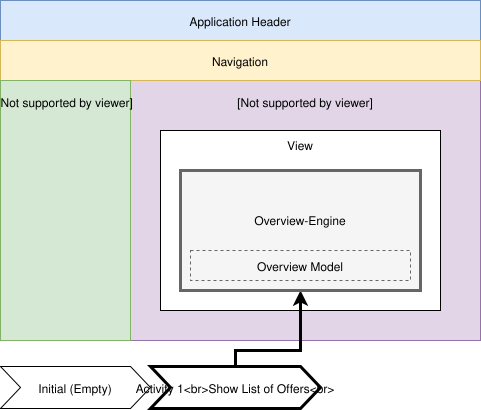
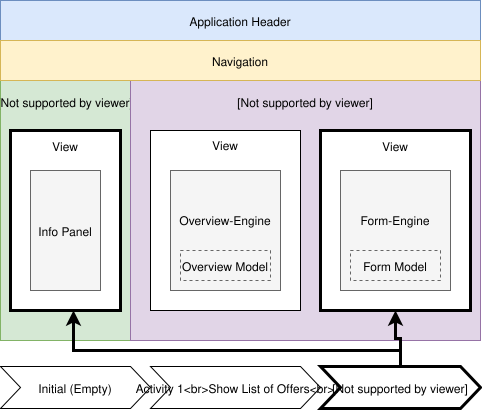

////
SPDX-License-Identifier: EUPL-1.2 OR LicenseRef-commercial
Copyright (c) 2012-2026 mgm technology partners GmbH
See LICENSE file for details. For commercial licensing: a12-license@mgm-tp.com
////

= From Activities to Views to Engines

Let's bring together the concepts we saw so far — views, activities, and also Engines — and show how they play together to present the UI. We stick to our insurance policy example (here labelled "offer").

[NOTE]
====
For simplicity reasons we will focus only on the default application frame layout. The behavior for custom layouts depends mainly on the the region and layout implementation.
====

When the application starts and no menu item is selected, the application frame is empty or shows the default content for the sidebar and content.

[#/basics/activities-views-engines/creating-first-activity]
== Creating the First Activity (Overview)

In the next step the user clicks on the menu item "Offer" and activity 1 is created with the Activity Descriptor "`{ "model": "offer"}`":

We will study the Application Model only in the next section, but note that this action is declared in the model.

As a result of creating this activity, scene directives are executed according to the Application Model. In this case: first clear the sidebar and the content regions, then add a view for showing the Overview Engine.

Note that until now the activity is only containing the Activity Descriptor but no data or models, which is also indicated by the loading state `"loading"`. As a consequence, the view cannot render much, maybe an animation to indicate this pending state, but not the Overview Engine. Loading of data and models is done through DataHandlers and orchestrated by the Client runtime.

The next step begins when the data and models are loaded and the loading state is changed to `"loaded"`. Now the view has all required parameters for the Overview Engine and can instantiate and render it inside the view.

== Creating the Second Activity (Detail)

The user now interacts with the overview and clicks on a row in order to edit the details of the offer. Here's what happens. The view issues a Redux action to create a second activity. This activity has the first activity as the initiating activity; but not as source activity, since it will get the offer document data from the server.

As a result of creating this new activity, directives are executed according to the Application Model. In this case:

* clear the sidebar region (but not the content region),
* then add a view in the sidebar for the info panel
* and another view in the content region for showing the Form Engine

Note again that until now the activity is only containing the Activity Descriptor but no data or models. As with the first activity, data and models are loaded and the loading state is updated accordingly.

As soon as the views have all required parameters, the view contents are updated with the actual information (sidebar) and Form Engine (content region).

== Changing the Selected Row in the Overview

A typical user interaction in this master/detail situation is the selection of another row in the master, i.e., overview. One would expect the following to happen in the UI: the form on the right is cancelled (possibly by asking the user for permission if the form has changed data) and the form content is replaced with the document data of the newly selected row. This breaks down into an action sequence and view changes like this:

. We start with just the activity 1 and showing the overview and the user selects a row in the overview.
. Just <</basics/activities-views-engines/creating-first-activity,like before>> the overview view dispatches an action (`create`) in order to create a dependent activity 2.
. Now the user selects another row in the overview.
. It needs to be checked if there exists a child activity of the overview activity.
** If no child activity exists, a (`create`) action can be dispatched in order to create a new dependent activity.
** If a child activity exists, this child activity needs to be cancelled by dispatching the (`cancelRequested`) action. It is possible to provide an activity to the (`cancelRequested`) action that replaces the canceled activity in order to avoid dispatching an additional (`create`) action after the cancellation.
