////
SPDX-License-Identifier: EUPL-1.2 OR LicenseRef-commercial

Copyright (c) 2012-2026 mgm technology partners GmbH

Dual License
------------
This source file is part of the mgm A12 Platform and available under
a choice of two different licenses:

1. Open-Source License - EUPL v1.2
   You may redistribute and/or modify this file under the terms of the
   European Union Public License, version 1.2 - see https://eupl.eu/.

2. Commercial License
   Alternatively, you may obtain a commercial license from
   mgm technology partners GmbH, that permits use of this software
   under different terms (including support and maintenance services).

   Please contact a12-license@mgm-tp.com for more information.

You must select and comply with exactly one of the above license options.

Warranty Disclaimer (applies to either option)
----------------------------------------------
THIS SOFTWARE IS PROVIDED "AS IS" AND WITHOUT WARRANTY OF ANY KIND,
WHETHER EXPRESS OR IMPLIED, INCLUDING BUT NOT LIMITED TO THE WARRANTIES
OF MERCHANTABILITY, FITNESS FOR A PARTICULAR PURPOSE AND
NON-INFRINGEMENT, EXCEPT WHERE SUCH DISCLAIMERS ARE HELD TO BE
LEGALLY INVALID. SEE THE RESPECTIVE LICENSE TEXT FOR DETAILS.
////

[#/basics/application-model]
= Application Model

So far we have focused on the runtime and understand how starting activities creates views in regions that show the UI elements. One piece of the puzzle is missing so far: how exactly do you specify which and how many views are associated with an activity? This section will explain that this association is in the Application Model, specifically in the "scene" descriptions.

== Overview

The Application Model is all about the structure of the UI in terms of regions and layout, and behavior – when and how UI components should be placed in the UI. The building blocks of the model are summarized in this diagram:

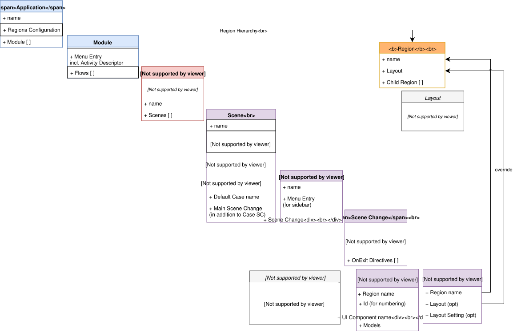

Let's go quickly through these elements:

=== Application

* Header specifies generic model properties like id, supported locales, annotations etc.
* Specifies the modules
* Regions configuration specifies the application frame and layouts.

=== Module

* Functional domain of an application
* Represented as "Main menu entry", that triggers the creation of the flow's initial activity.

=== Flow

* UI interaction bracket, i.e. it divides the user interaction into discrete parts. Think of it as a _micro-workflow_ on the client side.
* In this sense, it is also a closure for a set of connected UI configurations; specifically it breaks down into multiple steps in the flow that we denote _scenes_.

=== Scene

UIs in the Client are modeled using "Scenes", where a scene is "entered" when some configurable conditions are met. When a scene is entered, its specified scene change (which in turn contains scene directives) is executed. This, in turn, reconfigures the UI.

* Single UI configuration
* triggered by a change in the activities and activated by an Activity Descriptor match
* linked to a (required) prior scene (except initial scenes of a flow)
* AD match always includes the prior scene implicitly

=== Case

* Sub-case of an UI arrangement
* triggered by an explicit case change (manually) / activated by a case menu entry
* hence, all cases within a scene operate on the same activity!

=== Scene Change

* Contains directives that should be executed when the scene/case changes
* onEnter: When the scene/case is entered
* onExit: When the scene is followed by a next one (see <</basics/application-model/scene-changes,below>>)

Here's an example and break-down the UI and its changes in terms of flows, scenes and scene changes:

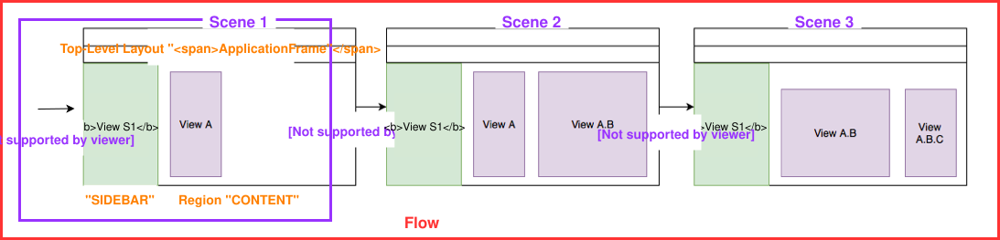

[#/basics/application-model/configuration-of-regions]
== Configuration of Regions

We have seen how applications can place contents of UI components in _regions_, like the content, sidebar and modal region. However, the Application Model allows arbitrarily named and even nested regions.

* In the Application Model, regions can have any name and there are no "predefined" regions . The semantics of the regions are defined by the layout that is assigned to the region.
* The tree of regions is defined (statically) in the Application Model.
* There is one top-level region - the application (or "app") region. If it has the `ApplicationFrame` layout then it resembles the classical application frame with the content and sidebar regions.

Here's the excerpt from the model that sets up the three regions of the previous examples:

[source,json]
----
{
	"region": {
		"name": "APP",
		"layout": { "name": "ApplicationFrame" },
		"subRegions": [
			{ "name": "CONTENT", "layout": { "name": "MasterDetail" } },
			{ "name": "SIDEBAR", "layout": { "name": "Null" } },
			{ "name": "MODAL", "layout": { "name": "Stack" } }
		]
	},
	"defaultRegion": ["CONTENT"]
}
----

The resulting region configuration then looks like this:

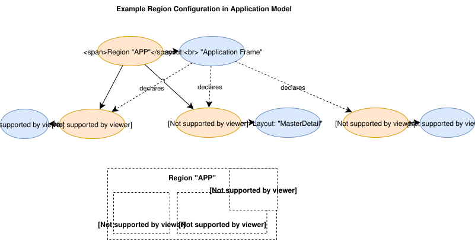

=== Region Layout

For each region, the layout must be specified by name with optional settings data. The provided layouts of the Client are shown here:

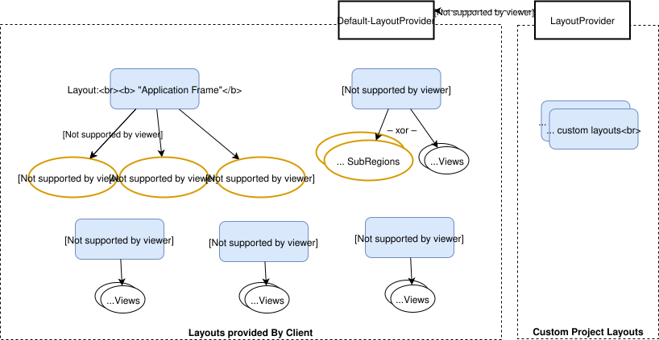

Please note that custom layouts can be easily installed and this setup is discussed further in the customization page.

Layouts for regions can be changed at runtime during a scene change, specifically by the `CLEAR_REGION` directive. See the page <</basics/application-model/scene-changes,Scene Changes>> for further details; this page also shows how to provide extra layout settings data in the dashboard example.

== Locales

The property locales is optional and currently unused. However, it is recommended to provide here all locales that are used in the Application Model.

== Modules

The Application Model is a composition of modules. The modules describe all the model aspects for a certain domain in your application. For example, an insurance application can be broken down into modules like partner, submission, offer and policy.

The idea here is that you can reuse modules and supporting code in different applications and put together modules to build up an application. This notion is expressed in the following diagram:

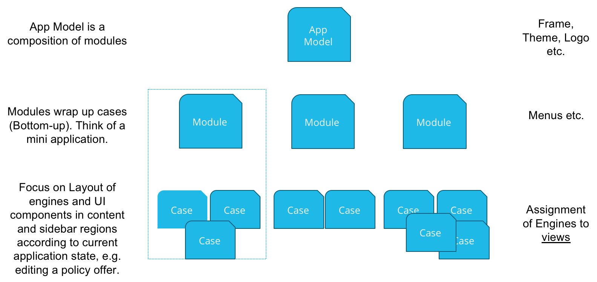
// FIXME: Images contains old terminology

Modules contain two pieces of information:

* *Module header including a menu entry*: each module can provide a menu entry that is shown automatically in the menu bar in the header.
* *Flows*: a flow contains usually many scenes that handle activities in the respective domain and are connection between activities and the view assignments in regions. For example, the offer module might consist of three scenes: the overview (list), editing an offer and adding/editing clauses.

=== Bottom-up Development

The diagram above also shows the supposed bottom-up development process. You can break up the full application into smaller parts. You begin with single scene, like showing a search filter with results (an overview in A12 jargon) or a detail form. Scenes can be assigned to teams and developed and tested in isolation as a single-scene "application". You now can wire single scenes together for a user interaction scenario and bundle related scenarios (typically of the same business entity like offer) into a flow of a module e.g. "offer". A module is a mini-application that again can be tested in isolation, and the modules can then finally combined into the full application.

=== Starting an Initial Activity Through the Menu

The application menu is automatically built from the Application Model. Each module can specify a menu entry like this:

[source,json]
----
{
	"menu": {
		"name": "offer",
		"label": { "en": "Offer" },
		"initialActivity": { "descriptor": { "model": "Offer_v3" } }
	}
}
----

When you click on a menu entry, an activity is started automatically with the Activity Descriptor content that is specified in the `descriptor` property. It is equivalent to `createPushActivityAction({ descriptor: {model: "Offer_v3"}, ...})`.

If the activity does not require any data loading, the property `withoutData` should be set. This is equivalent to the above push action with a `loadingState` set to `"without"`.

The label is localizable by providing different texts in a map. The key is hereby the string representation of the Locale object. Furthermore, it is possible to extend and override these texts with a <</advanced/localization/localizer,localizer>> by using the corresponding <</advanced/localization/menu-entries,localization key>>. Using a customized localizer does not require that a label is provided in the Application Model.

[#/basics/application-model/flows]
== Flows

A flow is a way to group together coupled UI interaction steps, we denote _scenes_. Examples of multi-step user interactions that could be modeled as flows are

* wizards that span multiple steps and involve more than one UI form on the Client footnote:[Note that multi step wizards can also be realized with just one form by using one screen per step.], e.g. mixing forms, lists/overviews etc.
* drilling down into a hierarchy of information. Take the example from the <</basics/views/example-design-study, Design Study>>: it starts with an overview of policy instances, then entering a specific policy document, and from here listing its general clauses, which are related or embedded information, and looking at various general clause instances of this list.

=== Starting a Flow

Flows are not directly instantiated and have no direct tie to activities. However, scenes are associated with activities through scene matches. And so we have a notion of _starting a flow_ by the fact that an activity will match a first scene in flow. More on this topic in the following section.

=== Multiple Flows (Outlook)

Flows are currently limited by the fact, that you can only run one flow at time: if you click an entry in the main menu, you start off a new flow, and a possible ongoing flow is stopped by cancelling the activities. However, this limitation will be lifted in future releases and then multiple flows can be "started" in parallel. This plays nicely together with the fact that activities form not only a sequence (w.r.t. to the "initiated by" link), but trees and even forests. A forest here means that Client supports running multiple top-level activities that each can have tree-like sub activities.

Here's an illustration of the idea of multiple flows spawned by multiple top-level activities:

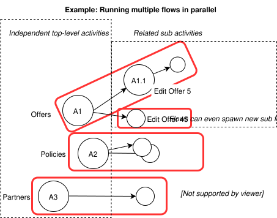

[#/basics/application-model/scenes]
== Scenes

Now we enter the heart of the Application Model. Scenes are the connection between activities and the view changes in the UI that are driven by them.

The procedure is roughly as follows:

. Selection criterion as *Match Condition* that has to match the Activity Descriptor of the given activity
. Layout changes as *Scene Changes*

The following screenshot shows the UI views that are shown for an activity:

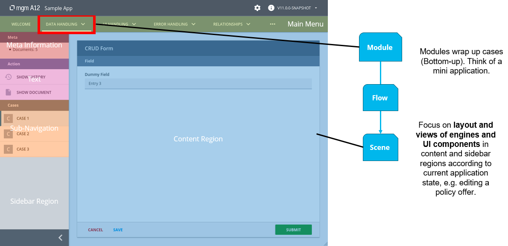

=== Scene Match

Now we address the question of how to choose a scene in the model for the given activity. All scenes of the model are candidates and are checked via a scene match as follows.

The match conditions for a scene must evaluate to true. A selector evaluates a single attribute of the condition and can evaluate it against matches:

|===
|Matches |Meaning

|`mustEqual: string` |The value must match the string
|`isSet: boolean` |A value for the given key must exist. The value can be anything.
|===

Let's see an example:

[source,json]
----
{
	"matchCondition": [
		{ "key": "model", "mustEqual": "Offer" },
		{ "key": "instance", "isSet": false }
	]
}
----

These match conditions evaluate to true for an Activity Descriptor like `{mode: "Offer" }`, but not for `{mode: "Offer", instance: "433" }`.

==== Required Prior Scene

Actually, there are two conditions that need to be met for a scene to be matched:

. *Required Prior Scene* (optional): The name of the scene within the flow scope that has to be activated "before" (that is, it is the predecessor). It basically just means, that the parent activity of the activity that matches the scene must match this referenced prior scene.
. The Match Condition as shown above.

==== Initial Scene for a Flow

A scene that does not have a required prior scene, can be matched by the match condition alone. This implies that this scene starts the flow, and thus we can derive the notion of initial scenes of flows. Note that

* there can be multiple initial scenes,
* and the ordering of scenes in the model is not relevant.

=== Example

Let's look at the example from the previous <</basics/application-model/flows,Flows>> page and walk through the changes that happen:

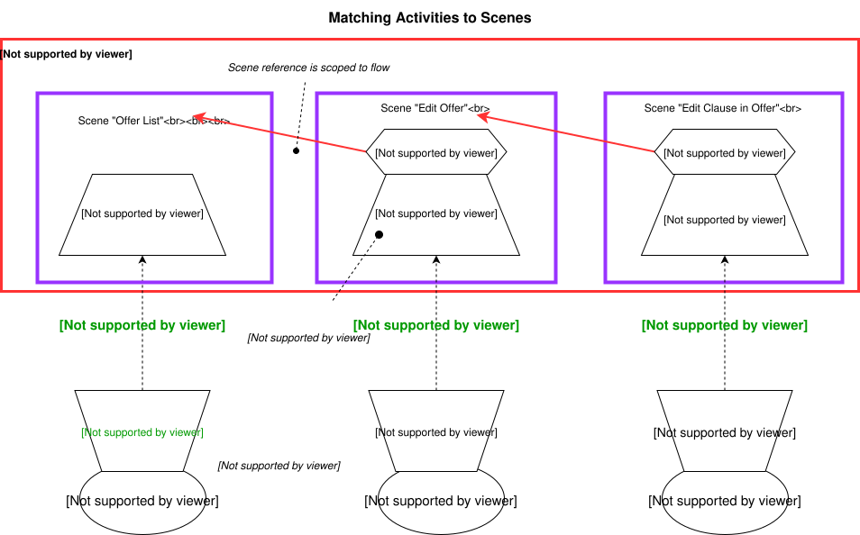

==== UI State 0: No Scene

* Let's say there is a module with a main menu entry `AD = {model: "Offer", action: "list"}`.
* The user clicks on this main menu entry.
* A new activity with the above AD is created.
* Note that there is no initiating activity and hence no prior scene. Therefore, only the scene match with the AD properties is conducted among all existing scenes in the model.
* As result, the scene "Offer List" is matched and thus triggered. The directives in the scene "Offer List" are executed and the respective UI is configured. This effect is not shown in the diagram above but will be illustrated in the following page.

==== UI State 1: In Offer List

* The user clicks "edit" on the row representing the document "55".
* A new activity with the AD properties: `{"Offer", instance: "55", action: "edit"}` is created.
* This time, an initiating activity exists and it matches the AD of "Offer List" (this match is a consequence of the defined required prior scene "Offer List"). Additionally, the newly created activity matches the AD of "Edit Offer".
* *Mixing Different Model Types*: Now that we have "prior scene" as an additional scene match criteria, we can omit the model match criteria. This allows to edit documents of different types out of a common scene.
* The scene "Edit Offer" is triggered and the directives in the scene "Edit Offer" are executed (not shown) and the respective UI is configured.

==== UI State 2: In Edit Offer

* The user selects "edit clause" for clause 5.
* A new activity with the AD model: `{"Clause", instance: "5", action: "edit"}` is created.
* Again, an initiating activity exists, and it matches the AD of "Edit Offer". Additionally, the newly created activity matches the AD of "Edit Clause in Offer". Therefore the scene "Edit Clause in Offer" is triggered.
* The directives in the scene "Edit Clause in Offer" are executed (not shown) and the respective UI is configured.

[#/basics/application-model/scene-changes]
== Scene Changes

Scene changes consists of scene directives that reconfigure the UI, specifically the contained views and layout of regions.

Let's just continue with the example from the <</basics/application-model/scenes,Scene>> page and refine it with the specific scene changes:

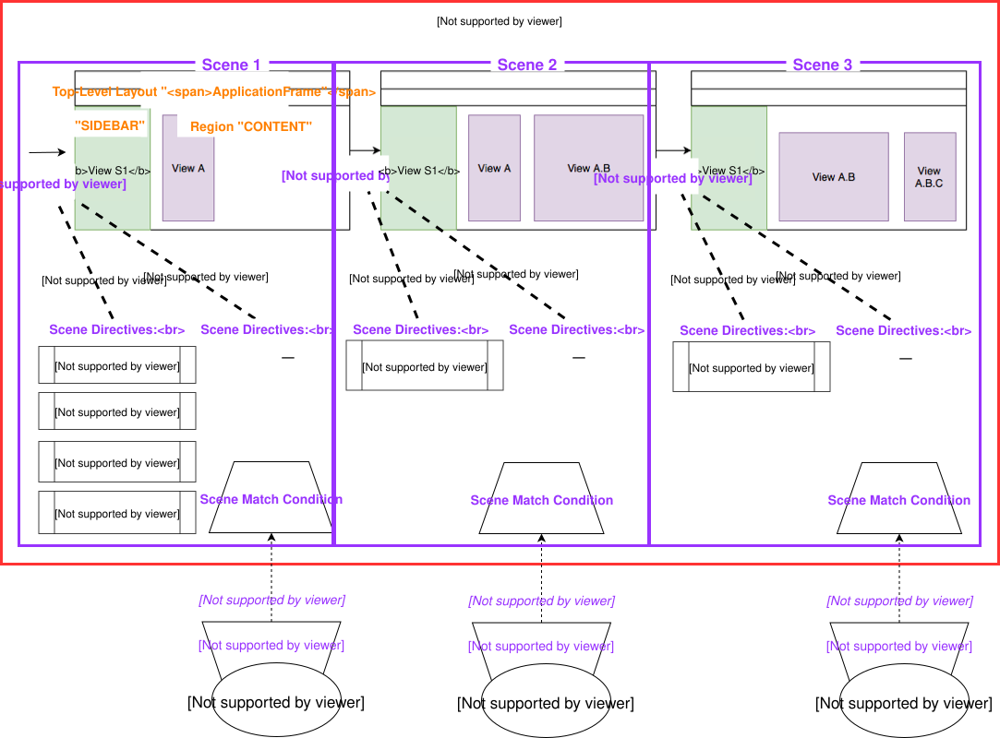

Here's an excerpt of directives for a scene change:

[source,json]
----
{
	"onEnter": [
		{ "type": "REGION_CLEAR", "region": ["CONTENT"] },
		{ "type": "VIEW_ADD", "region": ["CONTENT"], "name": "OverviewCRUD" }
	],
	"onExit": []
}
----

The directives of a scene change are either in the `onEnter` or in the `onExit` scene changes:

* `onEnter` directives are executed when a scene is selected.

* `onExit` directives are executed when a scene is followed by a next one, i.e., when a new activity is created and this causes a new match condition. This group is for preparing a follow-up situation. Note that the scene with the `onExit` does not end – there is just another scene (change) now on top of it (or you might think of a new nested scene).

[NOTE]
====
This is also the reason why there is no `onExit` directive for cases. Since cases are mutually exclusive and have no relationship to each other (e.g. there cannot be something like a "child" case), the condition "when a [case] is followed by a next one" would never be true in the first place.
====

Example: if you don't want to show the overview/list when a user selects an entry in the list, then you would change the scene example above to the following:

[source,json]
----
{
	"onEnter": [
		{ "type": "REGION_CLEAR", "region": ["CONTENT"] },
		{ "type": "VIEW_ADD", "region": ["CONTENT"], "name": "OverviewCRUD" }
	],
	"onExit": [{ "type": "REGION_CLEAR", "region": ["CONTENT"] }]
}
----

Scene changes can be given on the scene level but also on the <</basics/application-model/cases,case>> level. Scene changes on the scene level are always executed additional and before to any selected case.

The available directives are:

|===
|Directive |Meaning

|`REGION_CLEAR` |Changes the layout of a region. It can have (optional) geometry information which can be used by the layout to position its placeholders (into which the views are placed). The structure of the geometry information is therefore layout specific.
|`VIEW_ADD` |Adds a view to a certain region. You must specify a `name` property, which specifies the UI component by name that is to be shown in the view. The name is resolved during view rendering by looking for a match among the registered UI components. Optionally it is possible to specify view specific constraints that effects the layouts.
|===

Here some more sample excerpts:

[source,json]
----
{
	"onEnter": [
		{ "type": "REGION_CLEAR", "layout": { "name": "Stack" } },
		{
			"type": "VIEW_ADD",
			"name": "OverviewCRUD",
			"models": [{ "modelType":"overview", "name":"DiveLogOverview" }]
		}
	]
}
----

. The `REGION_CLEAR` directive can change the layout of the regions.
. The `VIEW_ADD` directive can provide specific model document names to use in the engine of the view. Here the Overview Model has the very specific "DiveLogOverview" ID.

To better understand the assignment of views to regions, it helps to think of a region as a container of views:

* A view is always added to the end of the view list of its region.
* By clearing a region explicitly with the `REGION_CLEAR` directive, you remove all previous views from the region.
* Replaying: The view list of a region is rebuilt if any new activity is created or when an activity is finished.

=== The Replay Algorithm

(This section contains very technical information that is optional.)

You might wonder why there is no directive to remove a view or other means for cleaning up the views that were added. But cleaning up is not required because it is done automatically. This works like this: if an activity is finished, the view assignment is reconstructed by the following *replaying algorithm*:

. Let's assume that activity `Ax` has finished and thus is removed from the list of activities `{A1, A2, ..., Ax, ..., An}`
. The leftover list `{A1, A2, ..., An}` is replayed
. Reset all assignments of views to regions, so that they are empty.
. `A_previous := undefined`
. Run a loop over `A1` up to `An` with `A_i` as the loop variable:
.. If `A_previous !== undefined`: execute the directives of the `onNext` group of `A_previous` (including the `onNext` directives of the selected view of `A_previous`).
.. Find the matching scene for `A_i` and execute the directives of its `onEnter` group (including the `onEnter` directives of the selected view).
.. `A_previous := A_i`

The replaying algorithm is performed as a Redux selector called `region`.

=== Layout Changes

Even though regions are setup in the <</basics/application-model/configuration-of-regions,Region Configuration>> part of the model, you can easily reconfigure the layout of any region in a scene change.

Let's illustrate this reconfiguration of the region layout by implementing a dashboard. The layout "Dashboard" is already provided by the Client. We just need to set it up with a specific columns/rows configuration, so that the dashboard's tiles can be positioned properly. The layout setting consists of a list of rows. Each row contains either a number of views or a list of container columns.

Let's implement this sample dashboard layout:

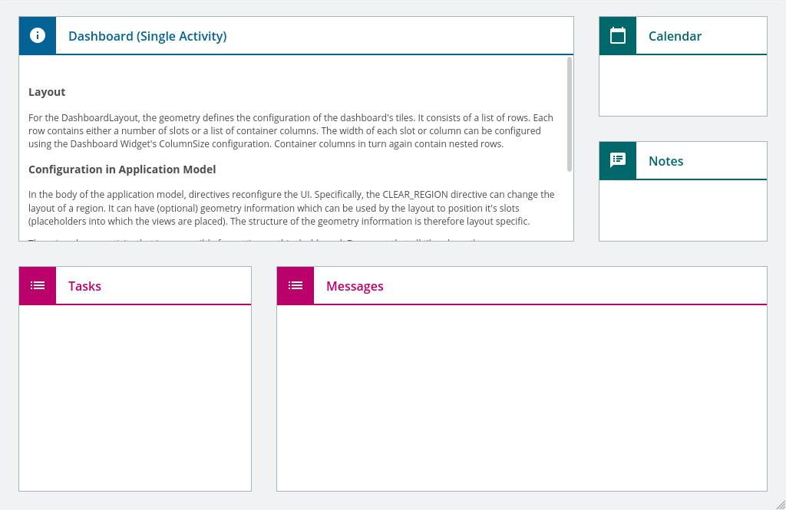

First, we break it down into the rows and columns like this:

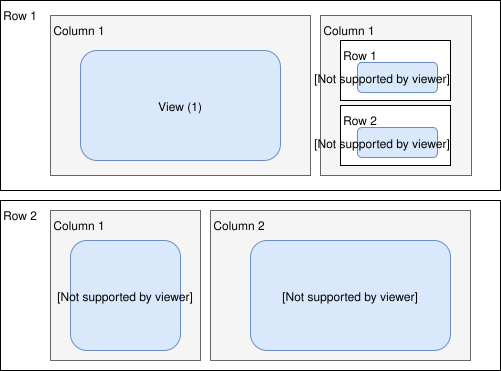

The dashboard should be assigned to a single activity. Thus, we set up the region for the dashboard with a `REGION_CLEAR` directive and the following layout setting. Additionally, we add the five views to the region in the right order. These views will then be placed into dashboard tiles by the dashboard layout.

[source,json]
----
{
	"sceneChange": {
		"onEnter": [
			{
				"type": "REGION_CLEAR",
				"layout": {
					"name": "Dashboard",
					"settings": {
						"rows": [
							{
								"columns": [
									{ "width": { "sm": 3, "md": 4, "lg": 9 } },
									{
										"width": { "sm": 1, "md": 2, "lg": 3 },
										"rows": [
											{ "columns": [ { "width": { "sm": 4, "md": 6, "lg": 12 } } ] },
											{ "columns": [ { "width": { "sm": 4, "md": 6, "lg": 12 } } ] }
										]
									}
								]
							},
							{
								"columns": [
									{ "width": { "sm": 4, "md": 2, "lg": 4 } },
									{ "width": { "sm": 4, "md": 4, "lg": 8 } }
								]
							}
						]
					}
				}
			},
			{ "type": "VIEW_ADD", "name": "DashboardIntroTile" },
			{ "type": "VIEW_ADD", "name": "DashboardCalendarTile" },
			{ "type": "VIEW_ADD", "name": "DashboardNotesTile" },
			{ "type": "VIEW_ADD", "name": "DashboardTasksTile" },
			{
				"type": "VIEW_ADD",
				"name": "OverviewCRUD",
				"models": [ { "modelType": "overview", "name": "CRUD-overview" } ]
			}
		]
	}
}
----

Note that the region is not explicitly given in the directives, since the "CONTENT" region is the default one, as it was specified in the <</basics/application-model/configuration-of-regions,Region Configuration>> part of the Application Model.

In summary, this is how we modelled the dashboard:

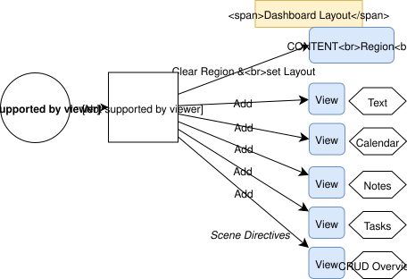

To follow up on the dashboard idea, if the user clicks a row in the overview in view 5, a form should come up. This form is of course a new activity, which in turn triggers a new scene. Let's assume that the dashboard in the "CONTENT" region should disappear while the overview is shown, even on desktops with enough width to show both. Well, discarding the dashboard activity is not an option. There are two obvious options: using an `REGION_CLEAR` directive in either the `onExit` scene change of the dashboard scene or the `onEnter` scene change of the overview scene. The former looks like this:

[source,json]
----
{ "onExit": [{ "type": "REGION_CLEAR", "region": ["CONTENT"], "layout": "MasterDetail" }] }
----

[#/basics/application-model/cases]
== Cases

Cases are an optional feature and can be defined within a scene. Think of them as mutual exclusive user interface components for editing the data. For example, when editing an offer, one case is the general data form, another case is the terms & conditions and yet another one is the coverages list. All these details are contained in the same offer document, but the designers broke it down into different cases.

Specifically, a case has

* A label which is typically shown in the sidebar menu and is localizable by providing different texts in a map. The key is hereby the string representation of the Locale object. Furthermore, it is possible to extend and override these texts with a <</advanced/localization/localizer,localizer>> by using the corresponding <</advanced/localization/cases,localization key>>. Using a customized localizer does not require that a label is provided in the Application Model.

* Scene changes with *directives*: The selected case contains a scene change that is executed after the scene change on the scene level. One typically places view with Engines here, while the case agnostic sidebar is setup on the scene level.

Only one case of a scene can be active (thus, mutual exclusive). This is tracked by the activity, which has a property `case` for the current case. If you change this case property, the region is updated (via the replay algorithm) to update the view assignment to regions.

When model descriptors are given in the onEnter directives of cases, the models will lazily be loaded once the case is active.

A menu of available cases can be shown by just adding the standard UI "GenericCaseMenu" component with a sidebar region. The menu then shows the name for each case, and with a click on a menu entry, the respective case is selected and the directives of the case's `onEnter` group are executed.

Here's an example scene that offers three cases and uses the GenericCaseMenu UI component:

[source,json]
----
{
	"scenes": [
		{
			"name": "Edit Offer",
			"description": "Specific Offer",
			"matchCondition": [
				{ "key": "model", "mustEqual": "Offer" },
				{ "key": "instance", "isSet": true }
			],
			"sceneChange": {
				"onEnter": [
					{ "type": "VIEW_ADD", "region": "SIDEBAR", "name": "OfferActions" },
					{ "type": "VIEW_ADD", "region": "SIDEBAR", "name": "GenericCaseMenu" }
				]
			},
			"defaultCase": "general",
			"cases": [
				{
					"name": "general",
					"label": { "en": "General" },
					"sceneChange": { "onEnter": [ { "type": "VIEW_ADD", "name": "GenericForm" } ] }
				},
				{
					"name": "terms",
					"label": { "en": "Terms & Conditions (General Conditions)" },
					"sceneChange": { "onEnter": [ { "type": "VIEW_ADD", "name": "TermsConditions" } ] }
				},
				{
					"name": "coverages",
					"label": { "en": "Coverages" },
					"sceneChange": { "onEnter": [ { "type": "VIEW_ADD", "name": "GenericOverview" } ] }
				}
			]
		}
	]
}
----

The following diagram shows the situation where an activity is matched to this "Offer" scene and the cases are switched from "general" to "terms":

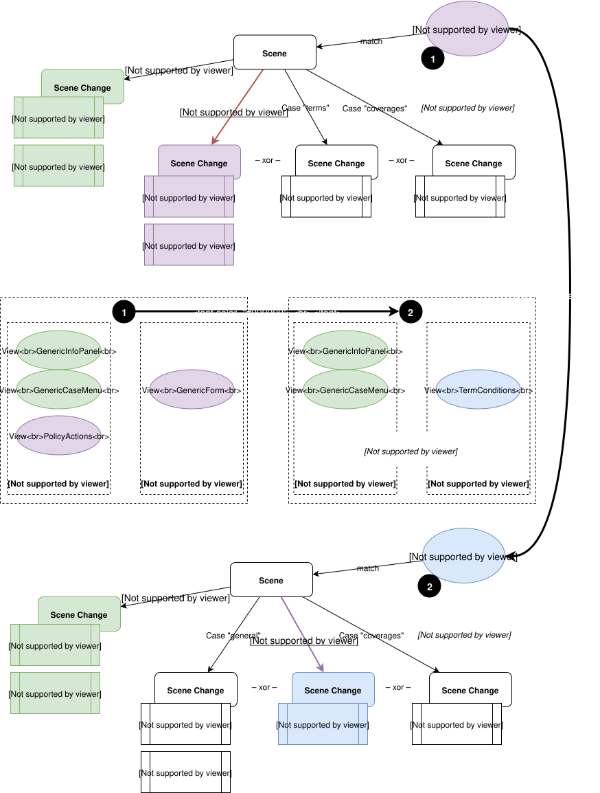

If the case "general" is selected, the resulting UI looks like this:

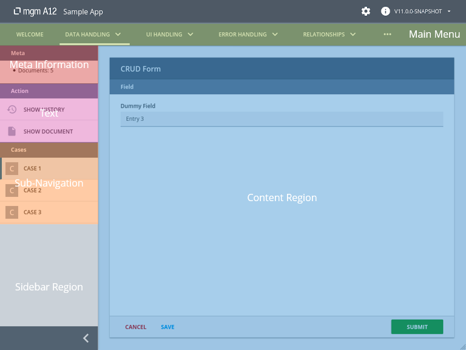

When the cases are switched from "general" to "terms", the UI adapts like this:

. Removal of the views specified for the previous case "general", i.e., the case with "GenericForm" UI component.
. Addition of the view specified for the new view "terms", i.e., the view with "TermsConditions" UI component.

=== Cases Versus Traditional "Tabs"

Some UIs use the "tabs" approach with only one tab being shown at a time. However, this is very physical. By introducing cases as an abstraction, you are free to come with any physical rendering you like. And quite easily so, by means of choosing the right layout (for the tabbed UI, you can easily provide a layout that shows views in exclusive tabs) for the "CONTENT" region.
