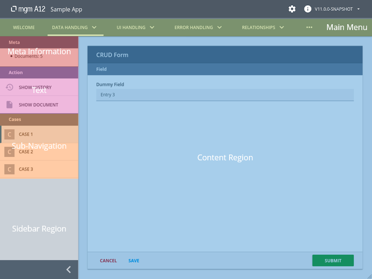

////
SPDX-License-Identifier: EUPL-1.2 OR LicenseRef-commercial
Copyright (c) 2012-2026 mgm technology partners GmbH
See LICENSE file for details. For commercial licensing: a12-license@mgm-tp.com
////

= Summary

Let's summarize what we've learned so far. Here are the key concepts:

* Regions: the application frame defines two regions: content area and sidebar. Each region contains views and uses a layout manager to derive which views are visible and how they are arranged.
* Activity: a user is always engaged in an activity like an overview or editing a form. Activities can be nested in a possible recursive master/detail manner. The next section explains activities further.
* Case: an activity can offer multiple cases, e.g., a complex business objects like an insurance policy can be broken down into different cases like general data, risks, terms&conditions, etc.
* Views: The views of a regions are derived by the activities and the current selected scene and case (through a mechanism called _condition matching_, which is explained in the <</basics/application-model,Application Model>> section).

