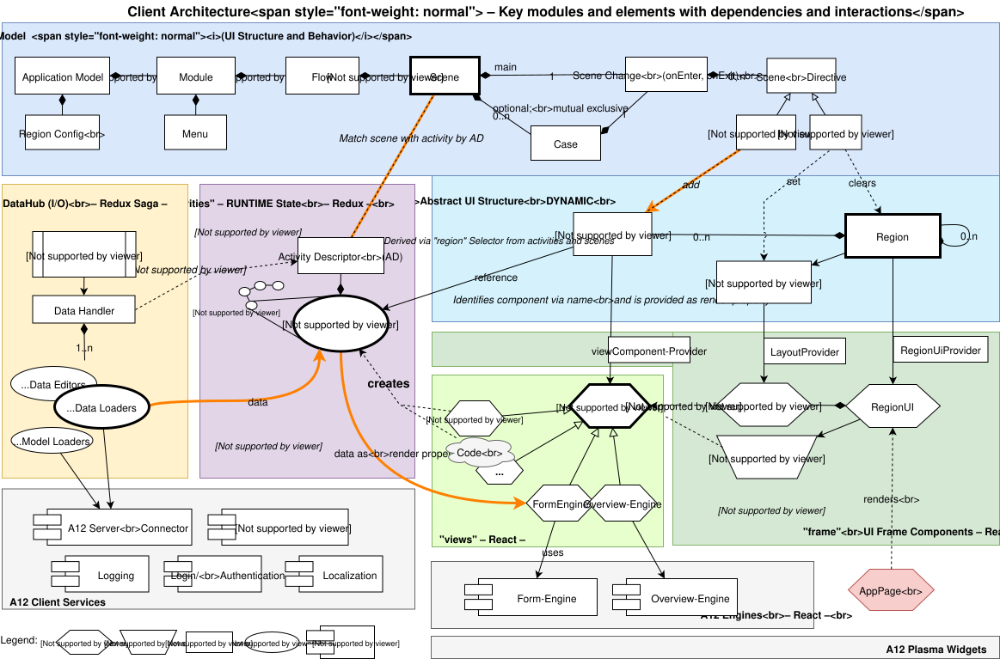

////
SPDX-License-Identifier: EUPL-1.2 OR LicenseRef-commercial

Copyright (c) 2012-2026 mgm technology partners GmbH

Dual License
------------
This source file is part of the mgm A12 Platform and available under
a choice of two different licenses:

1. Open-Source License - EUPL v1.2
   You may redistribute and/or modify this file under the terms of the
   European Union Public License, version 1.2 - see https://eupl.eu/.

2. Commercial License
   Alternatively, you may obtain a commercial license from
   mgm technology partners GmbH, that permits use of this software
   under different terms (including support and maintenance services).

   Please contact a12-license@mgm-tp.com for more information.

You must select and comply with exactly one of the above license options.

Warranty Disclaimer (applies to either option)
----------------------------------------------
THIS SOFTWARE IS PROVIDED "AS IS" AND WITHOUT WARRANTY OF ANY KIND,
WHETHER EXPRESS OR IMPLIED, INCLUDING BUT NOT LIMITED TO THE WARRANTIES
OF MERCHANTABILITY, FITNESS FOR A PARTICULAR PURPOSE AND
NON-INFRINGEMENT, EXCEPT WHERE SUCH DISCLAIMERS ARE HELD TO BE
LEGALLY INVALID. SEE THE RESPECTIVE LICENSE TEXT FOR DETAILS.
////

= Walkthrough

This page gives an overview of the key modules and elements of the Client. The focus is on high-level dependencies and interactions. The following concept map will guide us:

Read the above diagram like this: modules of the Client are in colored boxes. The box title briefly summarizes the responsibility of the module and also relevant technologies used. Go back to <<principles,Principles>> above to see a collapsed diagram of Clients' modules.

== Activity / Scene / View Cascade

Activities are not directly related to the UI. Actually, you can create activities (through Redux actions) in a _headless_ Client application, e.g., when testing on the command line.
Activities relate to UI only through indirection with the so-called *Activity/Scene/View* cascade. This page will give a quick walkthrough of what happens when a new activity is created. The following sections of this chapter contain other detailed walkthroughs for the specifics that we are omitting for now.

. *Application code* dispatches a Redux action to start a new activity. In the diagram locate the arrow labelled "creates" pointing towards "Activity". For example, when the user clicks on a row in the overview list, the row-selection handler would dispatch this Redux action.
. The *activity* is created. It contains, among other things:
* The *Activity Descriptor* (a key/value map with the two pre-defined keys "model" and "instance").
** The Activity Descriptor is the most relevant part; it denotes the intention of its activity and is then used to select an Application Model <</basics/application-model/scenes,scene>> that changes the UI.
* data (which might be missing at this point and loaded later from server - by DataLoaders - or from a parent activity - by a DataEditor)
* Various tracking information like loading state, saving state, processing state, whether the activity is locked or dirty, and also error information.
. The activity triggers now two actions: data loading (yellow area in the diagram) and UI updates (the blue and green rest in the diagram).
* The data loading is handled by so-called data-loading sagas, which is a loop that watches for new activities without loaded data. These sagas are registered during application startup. The default sagas delegate the loading (and saving later on) to registered DataLoaders (load/save from server) and DataEditors (read/write from data of a parent activity). The selection is done by inspecting the Activity Descriptor.
. The *region selector* (in the lower green "frame" module) is called and finds a matching Application Model scene for the Activity Descriptor. The scene contains
* a match condition that has to be matched against the Activity Descriptor (keys and values to match)
* a scene change with directives to execute, also an optional default case again with scene changes (not detailed here).
* Then the directives of the scene change are interpreted and result in a region specification containing the layouts for regions and views in these regions. In the diagram, locate the light blue box "model" just above the green "frame" module.
. The derived abstract UI structure is now used to render actual UI components via a provider mechanism, that maps names to actual UI components, e.g., a view with name "CRUDOverview" would map to a specific React component.
* Note that derived abstract UI structure is agnostic to any technology (even does not know about to React).
. The *layout* is a React component for a region that defines the visual structure of this region. The derived views will be rendered according to its specification and the available placeholders in the respective layouts. For example, the master-detail layout has two placeholders on the desktop and one on mobile devices.
* Views that are not displayed can be accessed through other means, e.g., a dropdown control that is shown by the layout.
* Applications are free to define their own layouts.
. The *UI component* for a view is rendered. There are many predefined views, e.g., for the Engines. Applications are free to define their own views or extend existing ones.
